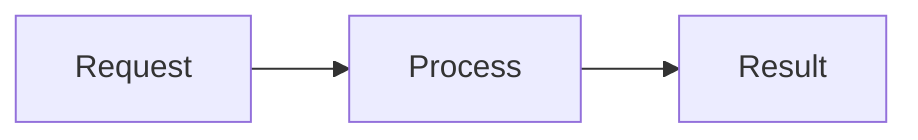

# Confluence

## Read and edit

Read the page's ID, version, and content representation before editing. Also
read the smallest section needed for the request. Preserve storage-format or ADF
nodes that are not part of the change; in particular, do not round-trip macros,
extensions, attachments, inline comments, task IDs, or layout nodes through
plain text.

Use the live update schema in this order:

1. A granular operation such as a targeted replace, insert, or node edit.
2. A replacement that explicitly carries the existing version and only the
   reconstructed target body.
3. A full replacement only when the user asked to rebuild the page or when the
   current representation cannot be preserved safely.

For a partial edit, take the current body from the server, change the requested
block, and send all other content unchanged. Do not recreate a page to edit it.
After writing, read the changed section and version again.

## Full-width pages

Use the width requested by the user. When they ask for a wide or full-width page,
or a wide table or diagram would otherwise be cramped:

- Prefer a documented create/update field such as `layout`, `pageWidth`,
  `appearance`, or `fullWidth`, using the exact type and value in the live schema.
- If there is no direct field, call the Atlassian `getContentFormatGuide` tool
  when available and use its supported full-width representation.
- Preserve an existing full-width setting during unrelated edits. Do not downgrade
  a page because the replacement body omitted the setting.
- Never invent an `ac:*` macro or attach CSS to fake a wide layout.

## Diagrams

Do not put a diagram source into an ordinary code block unless the user asks for
source. Select the output from the request:

1. For an editable source-first diagram, use Confluence's supported native Mermaid
   macro when the site exposes one.
2. For a draw.io diagram from Mermaid, use the configured `drawio` MCP server's
   `open_drawio_mermaid` tool. It accepts Mermaid and opens an editable draw.io
   diagram. Call `get_drawio_reference` once with `format: "mermaid"` before the
   first Mermaid diagram, then reuse that result. Use `postLayout: "elk"` for a
   flowchart with roughly 20 or more nodes, at least three decisions, a back-edge,
   or at least three distinct endpoints.
3. If the Confluence draw.io app and a save/insert operation are available, use
   that integration to attach or insert the saved `.drawio` artifact. Do not
   hand-author the app's macro wrapper from guesswork.
4. If the integrations cannot complete the save or insertion, return the editable
   draw.io link and state the one manual save/insert step that remains.

Keep diagrams wider than they are tall when the user wants a wide page:

Use `flowchart TD` for a deliberately vertical flow. Quote labels that contain
punctuation, avoid decorative subgraphs, and use only syntax the selected
renderer supports.

After writing a diagram, read the page back and check that the macro/node exists,
the source is complete, and the requested width still applies. Visual rendering
must be checked when the available integration exposes a preview.
