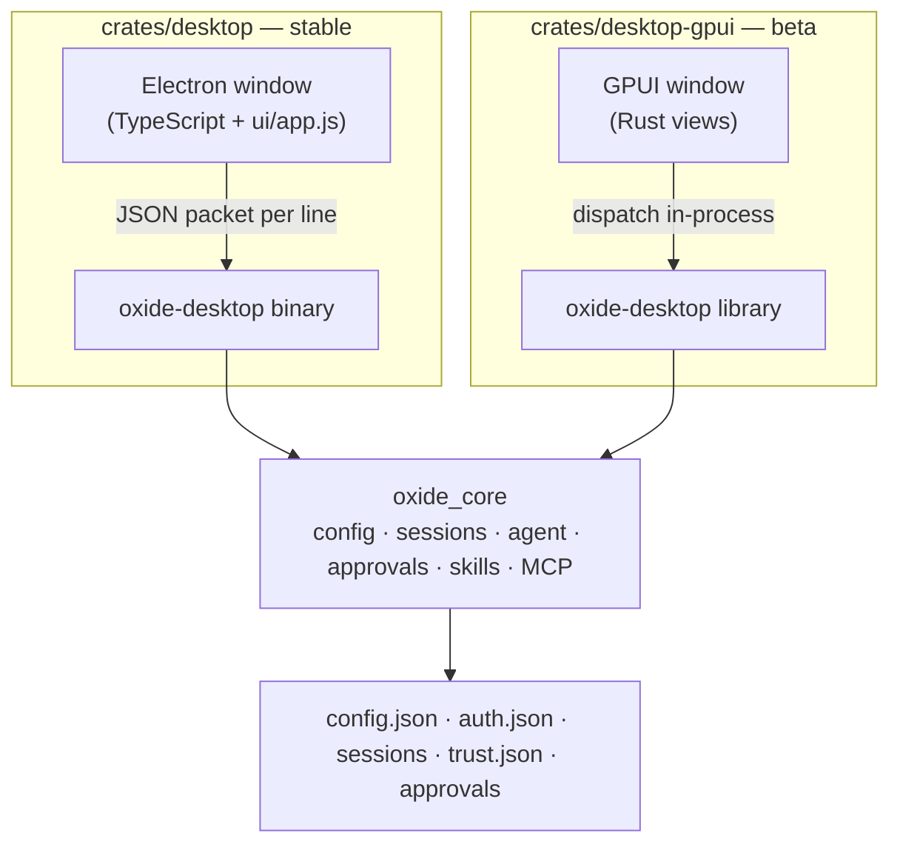

# Desktop app (Beta, GPUI)

`crates/desktop-gpui` is a **second desktop front-end for the same app**, drawn
with [GPUI](https://gpui.rs) instead of a webview. It is shipped as a **beta**:
it is the same Oxide — the same projects, chats, configuration, session store,
approvals and themes — with a native renderer, released on its own train beside
the stable Electron app in `crates/desktop` ([desktop.md](desktop.md)).

Both windows are clients of one engine. The stable app starts
`oxide-desktop` as a child process and speaks one JSON packet per line to it;
the beta links the same engine in-process — `oxide_desktop::commands::dispatch`
is the command contract, `oxide_desktop::bridge::Host` is the pipe — so a change
to a command, an approval rule, a turn, a theme or a preference reaches both
windows without being written twice.



## Beta status

The beta is marked everywhere it is seen: the window title reads **Oxide Beta**,
the topbar and sidebar wear a `BETA` pill, the bundle identifies itself as
`dev.oxide.desktop.beta` with the display name `Oxide Beta`, its installers are
`Oxide-Beta-*` beside the stable `Oxide-*`, and it releases from
`desktop-gpui-v*` tags with its own `desktop-gpui-latest` install link. It can
be installed beside the stable app and shares its configuration.

It is a beta because the surface is still catching up with the stable window
(see [What the beta covers](#what-the-beta-covers) below), not because it writes
anything different: projects, sessions, approvals, trust decisions, themes,
language and preferences are the shared stores, and both windows read and write
the same ones.

## Running

```sh
cd crates/desktop-gpui
cargo run
```

`cargo run -- --check` answers a handful of engine commands
(`list_projects`, `all_sessions`, `read_prefs`, `language`, `list_themes`,
`list_approvals`, then `theme_colors` for the theme the listing named) without
opening a window, and exits non-zero if any of them fails — the release workflow runs it against the packaged binary, and CI runs it
on every platform.

The package is its own Cargo workspace (like `crates/desktop`), so its
dependencies and lock file stay out of the core workspace's build graph.

### GPUI and the Metal toolchain

GPUI renders with Metal on macOS and compiles its shaders at build time unless
the `runtime_shaders` feature is on. This crate enables `runtime_shaders` — set
in `Cargo.toml` — so building does not need Xcode's downloadable Metal toolchain
and a machine with only Command Line Tools can still build the app.

## Packaging and releases

`crates/desktop-gpui/package.sh` produces this platform's artifact:

| Platform | Artifact |
| --- | --- |
| macOS arm64 / x64 | `Oxide-Beta-macos-<arch>.dmg` — `Oxide Beta.app` beside an `Applications` link, signed with the imported Developer ID identity and notarized when the App Store Connect key is configured, and signed ad-hoc when there is no identity |
| Linux x64 / arm64 | `Oxide-Beta-linux-<arch>-Setup.tar.gz` — the binary, its icon, a desktop entry and the bundled plugins |
| Windows x64 | `Oxide-Beta-win-<arch>-Setup.tar.gz` — the binary, its icon and the bundled plugins |

Without a Developer ID the script signs the bundle ad-hoc. That matters for
more than tidiness: a bundle whose binary carries only the linker's signature
fails `codesign --verify` as a bundle, and a copy that kept the download's
`com.apple.quarantine` attribute is `Killed: 9` on launch — the "damaged" app a
reader gets instead of an install. An ad-hoc bundle is valid, so a downloaded
build asks the ordinary "unidentified developer" question once: right-click →
Open, or `xattr -dr com.apple.quarantine "/Applications/Oxide Beta.app"`.
A local build from `./package.sh` has no quarantine attribute at all and opens
directly.

Each bundle carries `plugins/` beside the app (macOS: `Contents/Resources/plugins`),
which the front-end installs into the shared plugin store at launch the way the
stable app does, through `OXIDE_DESKTOP_PLUGINS` or the bundle's own layout.

`.github/workflows/desktop-gpui.yml` is the same shape as `desktop.yml`: the same
five hosts (macOS arm64 and x64, Linux x64 and arm64, Windows x64), the same
certificate import and App Store Connect key steps, a `--check` of the built
binary, a `desktop-gpui-v*` tag train that publishes on its own, and a permanent
`desktop-gpui-latest` alias release marked pre-release so `/releases/latest` keeps
pointing at a versioned release. The Linux runners install GPUI's system
libraries (X11, Wayland, fontconfig, freetype, Vulkan, ALSA) before building.

`scripts/set-version.sh desktop-gpui-v1.2.3` stamps the tag's version into
`crates/desktop-gpui/Cargo.toml` (and the root workspace version, as a
`desktop-v*` tag does).

CI (`.github/workflows/ci.yml`, job `desktop-gpui`) checks formatting, clippy
with warnings denied, the crate's tests, a release build and the engine check on
Ubuntu, macOS and Windows.

## What the window does

The layout mirrors the stable window: a 46px topbar that the window drags by,
with the platform's traffic lights inside it, navigation, the open chats' tabs
(or the thread's own folder and title while one is open) and a changes toggle; a
56px rail; the 300px sidebar (draggable) with its brand row — where the search
field takes the name's place when opened — New Chat, the project tree and the
threads touched most recently; the reading column with its transcript, the
welcome page before a thread is in it, and the composer; and a changes pane
docked to the right.

Every glyph is the SVG the stable window strokes, drawn from `src/icons.rs`: GPUI
rasterises one drawing into an alpha mask and tints it with the element's color,
so a mark is a file in that table rather than a character in the machine's font.
The brand mark is four filled triangles painted from a canvas, since a mask
would flatten its two colors into one. The window draws its own titlebar, so it
opens the first project's draft in memory: the welcome page's suggestions fill
that composer instead of being sent.

- **Projects and threads** — `list_projects`, `all_sessions` and
  `session_messages`; a project row expands into its threads and shows whether
  its folder still exists, its thread count and when it last ran. A thread runs
  from a project's own `+`, a search result, or a row. Adding a project uses the
  platform's folder picker (`App::prompt_for_paths`), the native counterpart of
  the stable window's `pick_folder`; removing one asks first.
- **A turn** — the composer sends through `send_prompt` with the project, the
  thread, the attachments and the chosen thinking level, and the streamed
  `agent-event` packets paint the same cards the stable window paints: the user's
  message, the answer with its markdown, thinking blocks with their duration,
  tool cards with their call, output and diff, errors, compaction notices, and
  the usage/context line under the composer. Its top row names the project and
  the branch `git_info` reports (and leaves the branch out when the folder is not
  a repository); its footer carries the attach and tools controls, the approvals
  dialog, the model and thinking chips and the round send/stop button. `Stop`
  cancels the run through
  `cancel_run`. A message typed while a turn is running is steered into it
  through `steer_run` (queued for the turn's end unless `follow_up` is `steer`,
  the same preference the stable window reads). Attachments are picked from disk
  with the native file prompt and sent as the data URLs the core's own
  attachment rules accept — the same images, PDFs and text the terminal and the
  stable window attach, under the same size limit.
- **Approvals and questions** — `approval-request` and `question-request` are
  answered in a dialog and inline on the card they belong to, through
  `resolve_approval` / `resolve_question` and the shared brokers, so the terminal
  and both windows answer the same request ids. The composer's lock opens the
  list of pre-approved tools (`list_approvals`) and clears it
  (`clear_approvals`). `question-closed` closes a request nobody answered in
  time.
- **Models, thinking, providers** — `list_models` (with refresh), `set_model`,
  `set_reasoning` and `project_info`; the model picker shows every provider's
  catalog with the model in use marked, and the thinking chip cycles the levels
  the active model advertises.
- **Trust** — `project_info.trust` gates a project's own skills, plugins, MCP
  servers and hooks exactly as the terminal does, with the banner and the
  dialog writing through `set_project_trust`.
- **Pinning and archiving** — a thread's right-click menu pins it through
  `set_session_pinned` or archives it, a project's `⋯` menu pins the project
  through `set_project_pinned` or removes it, and the sidebar's **Archived**
  listing reads `archived_sessions` and restores one through
  `unarchive_session`.
- **Changes** — `repository_changes` lists a thread's uncommitted files with
  counts and their diff previews in the docked pane, and `Undo` in its header
  restores the turn through `undo_turn` and the shared snapshot repository (the
  same restore the terminal's `changes undo` and the VS Code panel run). The work
  tree's totals stand above the composer as a chip (`N files changed +A −D`) that
  opens the pane, and every turn that changed files leaves an **Edited N files**
  card in the transcript — the count, the totals, the files it touched, `Undo`
  for the newest turn and `View changes`.
- **Project details** — the topbar's details toggle opens the right-hand column
  from `repository_changes`, `git_info` and `mcp_servers`: the project and its
  actions, `View changes` with the tree's totals, the repository's branch (or
  `Local checkout`), and the sources the thread can reach with their state
  (`Connected`, `Needs auth`, `Off`) and a way into the Customize page.
- **Menus and keys** — the macOS menu bar carries the app's own menu, File,
  View and Window menus over the same actions as the shortcuts (⌘N, ⌘W, ⌘B,
  ⌘,, ⌘⏎ for changes, ⌘⇧M for models, ⌘[ / ⌘], Esc to close a dialog, ⌘Q).
- **Appearance and language** — `theme_colors`/`set_theme` read the same theme
  files the CLI does. `language`/`set_language` read and write the shared
  language setting, and the catalog it answers with supplies the composer's
  placeholder; the window's other labels are English for now, so switching
  language changes what the terminal and the stable window say before it
  changes this window's own furniture.
- **Preferences** — `read_prefs`/`write_prefs` for the send key, follow-up
  behaviour, sidebar visibility, predictions, notifications, what they announce,
  keep-awake and text scale; the sidebar's own visibility and width follow them.
  The settings sheet is the stable window's two columns — Personal (General,
  Appearance, Notifications) over Integrations (Models, Shortcuts) — and each
  field is a row of labelled controls: segments for a choice, a switch for a
  flag, a link into the theme, language or shortcut picker, and a scale stepper.

### Accessibility

GPUI 0.2.2 paints its own tree and hands the platform no accessibility
information, so VoiceOver reads this window as empty: there are no roles, names
or values to announce. That is a limit of the framework, not something this
front-end can paper over.

What the window does offer: the keyboard shortcuts in the next section — Esc
closes whatever dialog is open, ⌘, opens settings, and ⌘N, ⌘W, ⌘B, ⌘⏎, ⌘⇧M,
⌘[ and ⌘] do the work their tooltips name — a composer that is a real text
editor with a caret, selection and the usual editing keys, and mouse affordances
that say what they do: every icon-only control carries a hover label from
`views::tip`, a dialog closes by a button that says `Close` as well as by its
glyph, and targets are 30px or larger (40px on the rail; the switch's hit area is
50×34 around a 38×22 track).

What is missing: a tab order into the window's controls, a focus ring drawn for
keyboard use, and an accessibility tree. The first two would need one stable
`FocusHandle` per control on `Root` and a key handler beside each click handler;
the third needs a gpui that emits one.

### What the beta covers

The beta is usable for the work the window is for: open a project, start, reopen
and search threads, watch a turn stream, answer its approvals and questions,
switch model and thinking level, trust a project, read the changes it left, and
switch theme, language and preferences — all against the shared stores.

### What the beta does not cover yet

These parts of the stable window are not in the beta yet. They are engine-backed
and planned, and the beta does not pretend otherwise:

- the terminal pane, the pull-request listing and the file viewer;
- the Customize surface (browsing, installing and enabling plugins, skills and
  MCP servers) — the rail's Customize page shows what is configured and the
  settings that act on it, but not the marketplace;
- the in-place review of a turn's diff (two-sided file restyle and hunk
  staging), which needs the staging actions wired;
- the provider Connect dialog (the model picker says how to connect, and the
  stored credential is read on refresh);
- `@path` completion and the `/` command palette in the composer, and the
  composer's inline predictions;
- the queue listing beside the composer (steered and queued messages are sent,
  but their queued rows are not drawn);
- updating in place: the beta does not self-install updates, because
  `oxide_core::updates::Component::Desktop` resolves the stable app's artifact
  names and an install would put the Electron app in the beta's place. Update
  the beta by installing its newest release.

## Verification

- `cargo test` in `crates/desktop-gpui`: the markdown block and inline parsers,
  the transcript model (a streamed answer becoming one card, a tool card
  keeping its call and result together, the one-line summary of a call), and
  every glyph in `src/icons.rs` — each drawing parses and rasterises to ink at
  the size the window paints it.
- `cargo clippy --all-targets -- -D warnings` in the crate.
- `./target/debug/oxide-desktop-gpui --check` against a real configuration. It
  prints the project and session counts its own model parsed, so a listing that
  arrives in a shape the sidebar cannot read shows up as `0 projects` rather
  than as a window that paints nothing.
- `./package.sh` on a Mac, which builds the release binary, signs and notarizes
  when asked to, and writes the `.dmg`.
