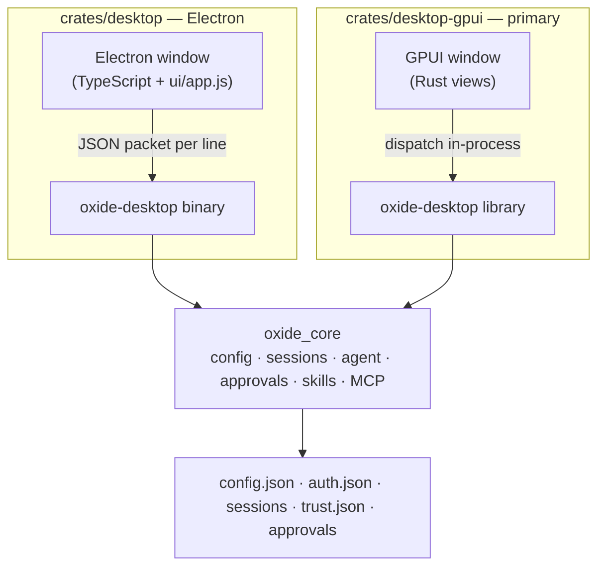

# Oxide Desktop GPUI

`crates/desktop-gpui` is the **primary desktop front-end**, drawn with
[GPUI](https://gpui.rs) instead of a webview. It is the same Oxide — the same
projects, chats, configuration, session store, approvals and themes — with a
native renderer. The Electron window in `crates/desktop` remains the fallback
during the migration ([desktop.md](desktop.md)).

Both windows are clients of one engine. The Electron starts
`oxide-desktop` as a child process and speaks one JSON packet per line to it;
GPUI links the same engine in-process — `oxide_desktop::commands::dispatch`
is the command contract, `oxide_desktop::bridge::Host` is the pipe — so a change
to a command, an approval rule, a turn, a theme or a preference reaches both
windows without being written twice.



## Release status

GPUI is the recommended desktop app and publishes as **Oxide Desktop GPUI**. The
mounted application keeps the product name **Oxide**, its bundle is `Oxide.app`,
and its bundle identifier is `dev.oxide.desktop`. It installs from the permanent
`desktop-latest` alias and releases on the `desktop-gpui-v*` train with titles
such as **Oxide Desktop GPUI v0.14.0**. The window's functional surfaces and
accessibility semantics mirror the Electron app. Both windows write the
same stores: projects, sessions, approvals, trust decisions, themes, language
and preferences.

## Running

```sh
cd crates/desktop-gpui
cargo run
```

`cargo run -- --check` answers a handful of engine commands
(`list_projects`, `all_sessions`, `read_prefs`, `language`, `list_themes`,
`list_approvals`, then `theme_colors` for the theme the listing named) without
opening a window, and exits non-zero if any of them fails — the release workflow runs it against the packaged binary, and CI runs it
on every platform.

The package is its own Cargo workspace (like `crates/desktop`), so its
dependencies and lock file stay out of the core workspace's build graph.

### GPUI and the Metal toolchain

GPUI renders with Metal on macOS and compiles its shaders at build time unless
the `runtime_shaders` feature is on. This crate enables `runtime_shaders` — set
in `Cargo.toml` — so building does not need Xcode's downloadable Metal toolchain
and a machine with only Command Line Tools can still build the app.

## Packaging and releases

`crates/desktop-gpui/package.sh` produces this platform's artifact:

| Platform | Artifact |
| --- | --- |
| macOS arm64 / x64 | `Oxide-macos-<arch>.dmg` — `Oxide.app` beside an `Applications` link in Electron Desktop's Finder layout and drag direction, signed with the imported Developer ID identity and notarized when the App Store Connect key is configured, and signed ad-hoc when there is no identity |
| Linux x64 / arm64 | `Oxide-linux-<arch>-Setup.tar.gz` — the binary, its icon, a desktop entry and the bundled plugins |
| Windows x64 | `Oxide-win-<arch>-Setup.tar.gz` — the binary, its icon and the bundled plugins |

Without a Developer ID the script signs the bundle ad-hoc. That matters for
more than tidiness: a bundle whose binary carries only the linker's signature
fails `codesign --verify` as a bundle, and a copy that kept the download's
`com.apple.quarantine` attribute is `Killed: 9` on launch — the "damaged" app a
reader gets instead of an install. An ad-hoc bundle is valid, so a downloaded
build asks the ordinary "unidentified developer" question once: right-click →
Open, or `xattr -dr com.apple.quarantine "/Applications/Oxide.app"`.
A local build from `./package.sh` has no quarantine attribute at all and opens
directly.

Each bundle carries `plugins/` beside the app (macOS: `Contents/Resources/plugins`),
which the front-end installs into the shared plugin store at launch the way the
Electron does, through `OXIDE_DESKTOP_PLUGINS` or the bundle's own layout.

The macOS bundle also declares why it reads the Desktop, Documents and Downloads
folders (`NSDesktopFolderUsageDescription` and its two siblings). Those folders
sit behind a per-app grant, and a copied image from one of them reaches the app
as a file URL the app has to open itself: without the keys the system has no
purpose to show and the read is refused, which a paste reports by naming the
grant to give (System Settings → Privacy & Security → Files and Folders, or
copy the file into the project).

`.github/workflows/desktop-gpui.yml` is the same shape as `desktop.yml`: the same
five hosts (macOS arm64 and x64, Linux x64 and arm64, Windows x64), the same
certificate import and App Store Connect key steps, a `--check` of the built
binary, a `desktop-gpui-v*` tag train that publishes on its own, and a permanent
`desktop-latest` alias release marked pre-release so `/releases/latest` keeps
pointing at a versioned release. The legacy `desktop-gpui-latest` alias remains
during the transition. The Linux runners install GPUI's system
libraries (X11, Wayland, fontconfig, freetype, Vulkan, ALSA) before building.

`scripts/set-version.sh desktop-gpui-v1.2.3` stamps the tag's version into
`crates/desktop-gpui/Cargo.toml` (and the root workspace version, as a
`desktop-v*` tag does).

CI (`.github/workflows/ci.yml`) checks formatting and clippy once in
`desktop-gpui-lint`, then runs the crate's tests, a debug build and the engine
check on Ubuntu, macOS and Windows. The optimized LTO build, installer and its
engine check remain in the tag-time `desktop-gpui` release workflow.

GPUI is pinned to Zed commit
`596dfdcf32d85d4d8d17a8887b4d0979ec7c5e14`, whose AccessKit integration emits
the platform accessibility tree. The dependency is pinned rather than following
Zed's moving `main` branch.

## What the window does

The layout mirrors the stable window: a 46px topbar that the window drags by,
with the platform's traffic lights inside it, navigation, the open chats' tabs
(or the thread's own folder and title while one is open) and a changes toggle; a
56px rail; the 300px sidebar (draggable) with its brand row — where the search
field takes the name's place when opened — New Chat, Activities and a project
tree limited to the five newest threads per project, followed by Recents for
sessions not already shown under a project;
the reading column with its transcript, the welcome page before a thread is in
it, and the composer; and a content-sized project details panel docked to the
right. The project details panel is open by default. Chat,
Projects, Customize and Settings are destinations in
one shell: each keeps the rail and topbar, while Projects uses a directory page
and Customize and Settings use the stable window's two-column navigation. The
topbar's Back, Forward and sidebar controls stay visible on destinations, with
Back and Forward painted as disabled when they have no destination.

Every glyph is the SVG the stable window strokes, drawn from `src/icons.rs`: GPUI
rasterises one drawing into an alpha mask and tints it with the element's color,
so a mark is a file in that table rather than a character in the machine's font.
The brand mark is four filled triangles painted from a canvas, since a mask
would flatten its two colors into one. The window draws its own titlebar, so it
opens the first project's draft in memory: the welcome page's suggestions fill
that composer instead of being sent.

That page waits for `list_projects`: until the engine has answered, the welcome
is the brand mark alone, so a project the window is about to open cannot be
announced as no folder at all, and the button that adds one cannot flash before
the list that would have offered it. The invite below the mark fades in over
180ms once the list is in, and only when its state changes, so a launch is one
reveal rather than two frames of the wrong page.

- **Projects and threads** — `list_projects`, `all_sessions` and
  `session_messages`; each project row has a disclosure control, selects the
  project when clicked, and reveals its compose and action controls on hover.
  Hovering the row does not open a floating card; the actions control opens the
  project card deliberately. The card follows Codex's compact project summary:
  the project name and pin, thread count and active state, checkout path, and a
  single **Edit project** action. That action opens the project name editor with
  pin and remove controls. Thread rows reveal pin and archive
  controls on hover; right-click opens the rename, pin and archive dialog. An
  open stored thread keeps the same persisted label in the topbar and sidebar,
  the open chat takes a refreshed stored title when a run finishes, and Recents
  lists only sessions not already shown under a project. An unnamed session
  combines a short subject line with the request below it, so a window or
  product label does not become the whole title.
  Creating a project uses the same name-and-source-folders sheet as the Electron
  window, adding source folders through `App::prompt_for_paths`. The selected
  project opens a draft and always asks for its own trust decision, including
  when an ancestor folder already has one. Removing a project asks first and the
  shared manager forgets that project's exact `trust.json` decision. Selecting a
  project when the open tab is still an untouched draft moves that draft to the
  picked folder instead of opening another tab, so stepping through the sidebar
  leaves one place to type; a tab that already holds work keeps it and opens a
  new one.
- **Activities** — the pulse control beside Search toggles the project tree for
  the activity feed, as Codex Desktop does. Priority lists waiting approvals,
  questions and running chats; Recent lists the newest stored threads. Opening
  a row leaves the feed in place, the control carries a dot while a turn runs,
  and Escape or the control returns to the project tree.
- **Navigation rail** — Chats starts a new chat, Projects toggles the project
  directory, More opens the searchable command menu, Worktrees opens the shared
  checkout dialog, Customize replaces Settings with the integrations page and
  otherwise toggles that page against Chats, and Settings toggles the settings
  sheet, matching Electron Desktop's rail.
- **A turn** — the composer sends through `send_prompt` with the project, the
  thread, the attachments and the chosen thinking level, and the streamed
  `agent-event` packets paint the same cards the stable window paints: the user's
  message, concise progress commentary, the answer with its markdown, tool cards
  with their call, output and diff, errors, compaction notices, and a context
  ring beside the composer controls. Provider reasoning stays private: the
  stored blocks are retained for protocol replay but neither a live turn nor a
  reopened thread paints them. A tool is one compact row by default; a successful result stays
  folded, a failure previews its first three lines, and the row or preview
  expands and collapses the full output and diff without making every result
  compete with the answer. The row's copy control keeps a shell command's full
  text, including later lines the one-line transcript summary does not show.
  Mermaid fences become native diagrams once their assistant step is complete;
  a large diagram is fitted to the raster ceiling instead of being rejected.
  Its top row names the project and
  the branch `git_info` reports (and leaves the branch out when the folder is not
  a repository); that branch is read again when a turn ends, when the window
  becomes active again, and just after a command is typed into the dock's own
  terminal, so one switched outside this window's knowledge shows up here; its
  footer carries the attach and tools controls, the approvals
  dialog, one combined model-and-thinking chip, and the round send/stop
  button. A send from a tab that has no thread of its own asks the engine for a
  `new` session rather than leaving the field out: the engine's own default is
  `latest`, which would append the message to whichever thread the project used
  last and leave the sidebar showing that thread unchanged. The
  three-dot tools control opens Electron's compact menu above the composer with
  Connect a provider, Project access, Agents and Keyboard shortcuts; Project
  access carries the selected folder's state, so it reads in the accent while
  that folder's own resources are trusted, and the menu does not
  dim the conversation or replace the composer with a centered dialog. The
  combined model-and-effort chip opens one compact composer-anchored popover:
  the current effort sits above the model row and a horizontal effort slider,
  and the model row opens the provider/model list in the same surface. Nothing
  dims or replaces the conversation. The transcript follows streamed output
  while the reader is at its end; the first upward scroll stops following, even
  when that scroll is smaller than a page, and scrolling back to the end resumes
  it. While reading earlier output, the floating down-arrow control above the
  composer returns to the latest message and resumes following new output. Each
  completed answer has a **More actions** control with copy-response
  and branch-in-new-chat actions. `Stop`
  cancels the run through
  `cancel_run`. A message typed while a turn is running is steered into it
  through `steer_run` (queued for the turn's end unless `follow_up` is `steer`,
  the same preference the stable window reads), and the queued or steering rows
  stay above the editor until the turn consumes them. The composer has one round
  control, as the page does: while a turn runs it stops that turn only when the
  box is empty, and a box with text in it offers that message's own action —
  steering, or queueing — with a hover label that names which (`Stop` also works
  from the keyboard as ⌘.). A run is steerable from the moment it is reserved, so
  a message typed while a cold start is still loading servers waits in the run's
  own queue for its first step; a message whose run has already gone back
  answers `false`, and the window keeps it out of that turn's transcript and
  starts it as the next turn of the same chat, even if the reader has moved to
  another tab. Attachments are picked
  from disk or pasted from the system clipboard and sent as the data URLs the
  core's own attachment rules accept — the same images, PDFs and text the
  terminal and the stable window attach, under the same size and count limits.
  Each turn leaves its own status-dot `Working for` / `Worked for` line in the
  transcript, updated once a second while it runs and kept above that turn's
  change card, so scrolling back through earlier turns preserves their clocks.
  A paste reads the pasteboard twice: the window's in-process read answers
  ordinary text immediately, while a picture or a path that names a file waits
  for the shared media reader on the background task and lands as an attachment
  when it answers, instead of holding the window still or inserting the file
  path as prose. A copy the reader cannot attach — a file macOS keeps behind a
  per-app grant, for one — answers with its reason and the window says it, since
  a refused read that said nothing would leave the paste invisible.
  Image attachments show a thumbnail in the composer, a larger preview in the
  sent message, and open in a full-size viewer when clicked. An attachment can
  be sent without text. The composer lists
  `list_commands` rows after `/` and calls `at_suggestions` for an `@path` under
  the caret. Choosing an `@path` completes the token in place. A bare built-in
  slash command runs its GPUI surface — `/model`, `/agent`, `/reasoning`,
  `/permissions`, `/trust`, `/mcp` and `/help` open their picker or listing —
  while configured commands, skills and argument forms such as `/mcp list`
  remain prompts for the shared runner.
- **Composer** — the editor starts at Codex's two-line height, grows to a
  capped scrolling surface, and keeps the caret in view. Markdown renders in
  place while the source stays editable: heading markers and emphasis
  delimiters are hidden, list and task markers become glyphs, and inline code
  keeps the normal text color over the same faint neutral wash as the page
  rather than borrowing the accent-colored selection brush. `~~struck~~` text
  is struck through, `[text](url)` and bare `http(s)://` links are underlined
  while their source stays editable, and quote lines keep their dim bar without
  becoming italic. Headings use the page's complete scale — `2em`, `1.5em`,
  `1.17em`, `1em`, `.83em` and `.67em` — so their painted rows, caret,
  selection and scroll follow that height. Fenced blocks render their contents
  literally in the monospaced code style, combined `***strong emphasis***` is
  preserved, escaped punctuation stays literal, entities show the character
  they name, and clicking a rendered Task List box toggles its `[ ]` / `[x]`
  source. Selection is a translucent accent wash separate from syntax colors.
  Selection maps between rendered and source text, and the field supports
  undo/redo, word/line navigation, double-click word selection and triple-click
  line selection. Single-line fields such as search keep one size whatever they
  hold.
- **Approvals and questions** — `approval-request` and `question-request` are
  answered in a dialog and inline on the card they belong to, through
  `resolve_approval` / `resolve_question` and the shared brokers, so the terminal
  and both windows answer the same request ids. The composer's lock opens the
  list of pre-approved tools (`list_approvals`) and clears it
  (`clear_approvals`). `question-closed` closes a request nobody answered in
  time.
- **Models, thinking, providers** — `list_models` (with refresh), `set_model`,
  `set_reasoning` and `project_info`; the model picker shows every provider's
  catalog with the model in use marked, while the combined popover's slider
  offers exactly the effort levels the active model advertises.
- **Trust** — `project_info.trust` gates a project's own skills, plugins, MCP
  servers and hooks exactly as the terminal does. A project that still needs a
  decision opens the trust dialog when its info arrives, including directly
  after the folder is added; the dialog lists the gated resources and both
  decisions write through the shared `set_project_trust`. A modal's scrim is a
  hitbox of its own, so while the dialog is up nothing behind it hovers, clicks
  or scrolls: the rows and cards under the wash stay still until it closes.
- **Pinning** — a thread's right-click menu pins it through
  `set_session_pinned`, and a project's `⋯` menu pins the project through
  `set_project_pinned` or removes it.
- **Git worktrees** — `worktrees`, `create_worktree`,
  `create_worktree_branch`, `remove_worktree` and `handoff_session` back the
  rail and composer entries. A chat can start in Local or a worktree, carry
  uncommitted changes into a new checkout, create its branch later, and hand its
  session between the two.
- **Changes** — `repository_changes` lists a thread's uncommitted files with
  counts, and the docked pane reviews either the newest turn or the working
  tree. A file expands into the aligned two sides from `change_sides` or
  `repository_sides`; the pane switches between split and unified layouts,
  folds long unchanged runs, refreshes the repository, and keeps each open file
  in place while another expands. `Undo` restores the newest turn through
  `undo_turn` and the shared snapshot repository (the same restore the terminal's
  `changes undo` and the VS Code panel run). Every turn that changed files
  leaves an **Edited N files** card in the transcript — the count, the totals,
  the files it touched, `Undo` for the newest turn, and `View changes`. The
  card's three-dot menu copies the complete change summary or opens the review,
  matching Codex Desktop.
  Repository files can be staged, unstaged or reverted from the pane, and each
  changed block carries its own `Stage hunk` / `Unstage hunk` action through
  `shape_change`. **Open file** opens the reviewed file in the shared viewer.
- **Workspace panel** — the right-hand dock has Changes, Terminal and Pulls
  tabs. The terminal starts in the thread's project or worktree through
  `terminal_open`, renders a real `vt100` screen from the engine's output, sends
  ordinary and control keys through `terminal_write`, and closes its shell when
  the pane or destination is left. Pulls reads `pull_requests`, opens one through
  `pull_request`, and shows its description, checks, files and conversation.
- **File viewer** — `file_view` backs a viewer for Markdown, images, CSV and
  source text. Markdown renders through the transcript's own renderer, images
  use their data URL, CSV becomes a table, source is shown in a monospaced
  reading surface, and the viewer reports truncated files instead of silently
  cutting them.
- **Project details** — the topbar's details toggle opens the right-hand column
  from `repository_changes`, `git_info` and `mcp_servers`: the project and its
  actions, `View changes` with the live tree totals used by the composer's
  change pill, the repository's branch (or
  `Local checkout`), the repository's pull request for the current branch when
  `pull_requests` finds one, and the sources the thread can reach with their
  state (`Connected`, `Needs auth`, `Off`) and a way into the Customize page.
  Like Codex Desktop, the toggle and ⌘J are available only while a chat is
  open, report whether the panel is expanded, and show or hide the same panel
  without leaving a stale dock behind. Opening a dock tab temporarily gives the
  details pane's width to the dock without forgetting whether the reader had
  details open; closing the dock restores that pane, while its own button
  switches straight back to it. The Changes control is active only while Changes
  is the open dock tab: pressing it while Terminal or Pulls is open switches to
  Changes, and pressing it again closes Changes rather than closing whichever
  unrelated tab happened to share the dock.
- **Customize and providers** — the Customize destination loads
  `plugin_catalog`, searches installed and marketplace plugins, adds, updates
  and removes marketplaces, and installs, enables, disables and uninstalls
  plugins through `change_plugin`. MCP rows can be enabled or disabled, have
  their model exposure cycled, and authorize through the same shared MCP store.
  The provider dialog loads `list_providers`, filters them, reuses a stored
  credential or accepts a key/model/base URL, and connects through `login`.
- **Predictions** — after a turn ends, an empty composer can request the next
  message through `predict`, paint it above the editor, and insert it as an
  editable draft with Tab or a click without sending it.
- **Menus and keys** — the macOS menu bar carries the app's own menu, File,
  Edit, View, Window and Help menus over the same actions as the shortcuts
  (⌘N/⌘T, ⌘W, ⌘B, ⌘⇧A for Activities, ⌘J, ⌘,, ⌘⏎ for changes, ⌘⇧M for models, ⌘⇧G for Git
  worktrees, ⌘+ / ⌘− / ⌘0 for text size, ⌘1–⌘9 for the sidebar's chats, ⌘[ /
  ⌘], Esc to close a dialog, ⌘Q). The application menu has About, Check for
  Updates, Settings, Hide and Quit; the update dialog checks the
  `desktop-gpui-v*` release train and offers the installer it finds.
  Back leaves Settings, Customize or Projects before it walks the open-chat
  history.
- **Updates** — **Check for Updates** resolves the desktop app's
  `desktop-gpui-v*` train through the shared release rules. A packaged `.app`
  installed on macOS downloads the matching `.dmg`, verifies its SHA-256
  against GitHub's release metadata, replaces the running bundle, and offers
  **Restart and Install**. A source build, an administrator-owned copy, or a
  platform distributed as an archive gets **Download**, which writes the
  verified installer into Downloads for the reader to open. The progress view
  reports checking, transfer bytes, checksum verification and installation,
  and can cancel until the bundle is being put in place.
- **Appearance and language** — `theme_colors`/`set_theme` read the same theme
  files the CLI does, previewing each theme's semantic colors in a selectable
  card before it is applied. `language`/`set_language` read and write the shared
  language setting, and the catalog it answers with supplies the composer's
  placeholder; the window's other labels are English for now, so switching
  language changes what the terminal and the Electron app say before it changes
  this window's own furniture.
- **Preferences** — `read_prefs`/`write_prefs` for the send key, follow-up
  behaviour, sidebar visibility, predictions, notifications, what they announce,
  keep-awake and text scale; the sidebar's own visibility and width follow them.
  Settings is a full-window destination with a 232px navigation column —
  Personal (General, Appearance, Notifications) over Integrations (Plugins,
  Skills, MCP servers, Shortcuts) — and each field is a row of labelled
  controls: inline theme and language choices, segments for other choices, a
  switch for a flag, and a scale stepper.

### Computer Use

Oxide Desktop GPUI recognizes the shared `oxide-computer-use` MCP server and
shows a mouse indicator, the latest returned screenshot, Stop task, and
per-app policy controls in the transcript and project details. These are
snapshots rather than an isolated background desktop or continuous video feed.
The optional native helper adds a separate macOS app identity, launch services,
permission diagnostics, and a native menu-bar stop control.

**The helper has not been Apple Developer ID-signed or notarized for release.**
Its documented default is an ad-hoc development build, so macOS Gatekeeper may
warn about or block it. See the
[helper guide](../crates/desktop/computer-use/README.md) and the
[parity review](oxide-reins-parity.md) before installing it.

### Accessibility

GPUI publishes the window through AccessKit on macOS, Windows and Linux. Oxide
annotates its native tree with application, toolbar, navigation, complementary,
main, dialog, tab-list, tab, list, tree-item, article, terminal and text-input
roles. Buttons and icon controls have names; switches expose their toggled
state; tabs expose the selected item; fields expose their values and
placeholders; transcript entries have speaker/content labels; and the terminal
exposes its text value. Interaction annotations add native click, focus and
set-value actions, so assistive technology is not limited to reading the screen.

What the window does offer: every ordinary button and icon control is a tab stop
with a visible focus ring, and Enter or Space activates the focused control.
Tab moves forward and Shift-Tab moves backward when focus is outside a text
editor or the terminal; text fields and the terminal keep their own Tab behaviour.
The keyboard shortcuts in the next section — Esc
closes whatever dialog is open, ⌘, opens settings, and ⌘N, ⌘W, ⌘B, ⌘⇧A, ⌘⏎, ⌘⇧M, ⌘⇧G,
⌘[ and ⌘] do the work their tooltips name — a composer that is a real text
editor with a caret, selection and the usual editing keys, and mouse affordances
that say what they do: every icon-only control carries a hover label from
`views::tip`, a dialog closes by a button that says `Close` as well as by its
glyph, and targets are 30px or larger (40px on the rail; the switch's hit area is
50×34 around a 38×22 track).

### Desktop coverage

GPUI covers the same desktop workflow as the Electron app: projects,
threads and thread search; streamed turns, approvals and questions; models,
thinking and providers; trust; reviews, hunk staging and undo; the PTY, pull
requests and file viewer; plugin marketplaces, skills and MCP controls;
predictions; themes, language and preferences.

## Verification

- `cargo test` in `crates/desktop-gpui`: the markdown block and inline parsers,
  the transcript model (a streamed answer becoming one card, a tool card
  keeping its call and result together, the one-line summary of a call), the
  composer's input rules, new-project selection and nested trust state, terminal
  parsing and key encoding, review-hunk construction, and every glyph in
  `src/icons.rs` — each drawing parses and rasterises to ink at the size the
  window paints it.
- `cargo clippy --all-targets -- -D warnings` in the crate.
- `./target/debug/oxide-desktop-gpui --check` against a real configuration. It
  prints the project and session counts its own model parsed, so a listing that
  arrives in a shape the sidebar cannot read shows up as `0 projects` rather
  than as a window that paints nothing. It also reads the provider catalog and
  plugin marketplace catalog used by the Connect and Customize surfaces.
- `./package.sh` on a Mac, which builds the release binary, signs and notarizes
  when asked to, and writes the `.dmg`.
