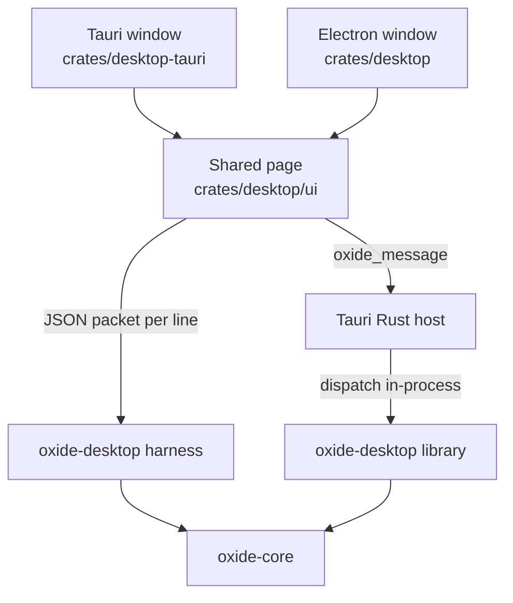

# Oxide Desktop Tauri

`crates/desktop-tauri` is the primary desktop app. It uses Tauri 2.12.7 for the
window host and loads the exact web page Electron uses from
`crates/desktop/ui`. The host links `oxide-desktop` in-process, so projects,
sessions, turns, approvals, preferences, themes, plugins and configuration are
the same stores the terminal, Electron app and editor extension use.

The two desktop front-ends deliberately share one page. Tauri supplies the
packet bridge, native folder picker, external links, notifications, badge,
zoom, sleep blocker, menus and relaunch; it does not maintain a second copy of
the product UI. This makes a layout, transcript, composer or workflow change
visible in both hosts unless a Tauri-specific check catches a host integration
gap first.



## Running and checking

```sh
node scripts/prepare-diagrams.mjs desktop
cd crates/desktop-tauri
cargo run
```

`cargo run -- --check` starts the shared engine without a window and dispatches
the commands the page needs at launch. The release workflow runs this against
the packaged binary on every platform.

The crate is its own Cargo workspace. Its focused checks are:

```sh
cd crates/desktop-tauri
cargo test
cargo clippy --all-targets -- -D warnings
node check-shell.mjs
```

The page's own behavior remains covered by
`node crates/desktop/check-app.mjs`, and the Electron shell contract by
`node crates/desktop/check-shell.mjs`.

## Tauri bridge

`tauri.conf.json` enables the global Tauri API only so the local page can install
the same `__electrobunHostBridge` interface Electron's preload installs. The page
sends its existing request packets through `oxide_message`; responses and engine
events return on `oxide:to-page`.

The page registers its event handlers before it sends `native_ready`. The host
holds launch events until then, which preserves update and catalog events that
otherwise happen before the webview's JavaScript is listening.

Host-owned requests are handled in Rust rather than sent to the engine:

| Request | Tauri service |
| --- | --- |
| `pick_folder` | `tauri-plugin-dialog` native folder chooser |
| `open_url` | `tauri-plugin-opener`, limited to HTTP(S) |
| `notify` | `tauri-plugin-notification` |
| `set_badge` | `WebviewWindow::set_badge_count` |
| `set_zoom` | `WebviewWindow::set_zoom` |
| `set_awake` | `keepawake`, preventing idle system sleep |
| `set_native_language` | rebuilds the macOS menu with shared translated labels |
| `set_native_shortcuts` | rebuilds menu accelerators from saved page bindings |

Other requests dispatch through the same `oxide_desktop::commands::dispatch`
contract as Electron. The page's generic update commands are mapped to the
Tauri release train (`check_tauri_updates`, `install_tauri_update` and
`download_tauri_update`) so a Tauri build never offers an Electron installer.
On macOS, an update restart waits for the replaced process to exit before
opening the bundle through LaunchServices. Tauri's default `open -n` relaunch
briefly creates a second application instance, which leaves two Oxide Dock
icons during an update.

## Packaging

`package.sh` builds the release binary and produces:

| Platform | Artifact |
| --- | --- |
| macOS arm64 / x64 | `Oxide-macos-<arch>.dmg` containing `Oxide.app` |
| Linux x64 / arm64 | `Oxide-linux-x86_64-Setup.AppImage` / `Oxide-linux-arm64-Setup.AppImage`, and `Oxide-linux-<arch>-Setup.tar.gz` |
| Windows x64 | `Oxide-win-x64-Setup.exe` (per-user NSIS installer; `/S` installs silently) |

The bundle keeps the same product name, identifier, icon and installer asset
names as Electron, which lets the shared updater resolve a release on every
platform. macOS signing and notarization use the imported Developer ID and App
Store Connect credentials when configured; otherwise the bundle is signed
ad-hoc.

Linux needs WebKitGTK 4.1 and GTK 3 at runtime. Windows uses the system WebView2
runtime. On macOS Tauri uses the system WKWebView.

The versioned release train is `desktop-tauri-v*`. The permanent
`desktop-latest` alias points at the newest Tauri installers;
`desktop-tauri-latest` is its component-specific name, and
`desktop-gpui-latest` remains only for links from the former front-end.

## Parity boundary

Tauri and Electron perform the same Oxide workflows because they render the
same page and dispatch the same engine contract. The Tauri host check compares
the page's host-owned calls, packet names, update mapping and release naming so
a host service cannot silently disappear during maintenance. Platform-specific
webview rendering still needs packaged smoke tests on macOS, Windows and Linux;
that is a rendering verification boundary, not a separate UI implementation.
