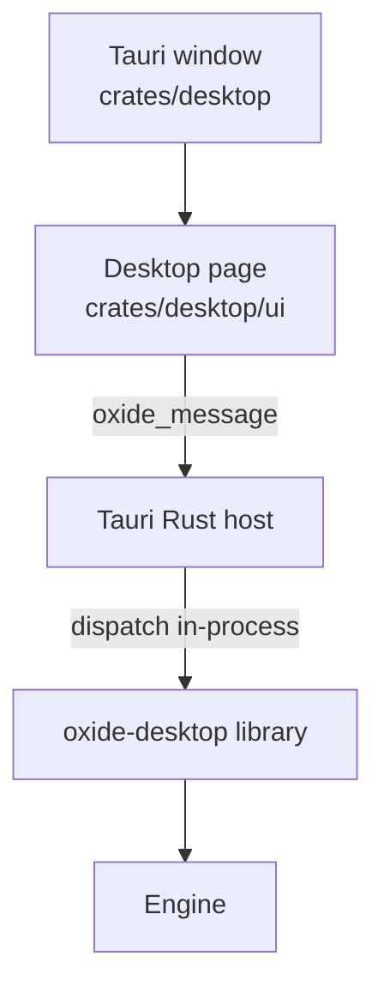

# Oxide Desktop

`crates/desktop` is the native desktop app. It uses Tauri 2.12.7 for the window
host and loads the page from `crates/desktop/ui`. The host links the desktop
engine in-process, so projects, sessions, turns, approvals, preferences, themes,
plugins and configuration are the same stores the terminal and editor extension
use.

Tauri supplies the packet bridge, native folder picker, external links,
notifications, badge, zoom, sleep blocker, menus and relaunch. The page remains
one shared implementation with the VS Code transcript behavior where the same
rules apply.

The shared page owns native editing. Tauri's Edit-menu roles reach the focused
webview editing host, so the Markdown composer maps copy, cut, undo and redo to
its source model, while the terminal exposes itself as an editing host but
routes the native paste event to the PTY, copies only terminal selections and
refuses native DOM edits. Terminal paste deliberately avoids
`navigator.clipboard.readText()`, which WebKit presents as another Paste
permission callout rather than a direct paste.

The right-hand dock also carries a project editor. It uses VS Code's Monaco
engine, loaded from `node_modules/monaco-editor` into the ignored
`ui/vendor/monaco` directory by `scripts/prepare-editor.mjs`, so the release
stays offline and the launch does not pay for the language runtime until the
editor is opened. Open it from the code control in the title bar, **View >
Editor**, or `⌘E` / `Ctrl+E`; `⌘S` / `Ctrl+S` saves. The picker uses the same
ignore-aware project file walk as composer `@path` completion. Any UTF-8 file up
to 8 MiB is editable; unknown extensions fall back to plain text rather than
being refused. Saves carry the digest read when the file was opened and are
refused if an agent turn changed the file in the meantime. Use **Revert** to
reload the disk copy after a refused save.

Changes, Editor and Terminal each have an **Enter fullscreen view** control in
their header. It hides the conversation while that body fills the workspace;
the same control restores the dock, and `Esc` does the same before closing the
panel.



## Running and checking

```sh
cd crates/desktop
pnpm install
node ../../scripts/prepare-diagrams.mjs desktop
cargo run
```

`cargo run -- --check` starts the shared engine without a window and dispatches
the commands the page needs at launch. The release workflow runs this against
the packaged binary on every platform.

The crate is its own Cargo workspace. Its focused checks are:

```sh
cd crates/desktop
cargo test
cargo clippy --all-targets -- -D warnings
node check-shell.mjs
```

The page's behavior is covered by `node crates/desktop/check-app.mjs`.

## Tauri bridge

`tauri.conf.json` enables the global Tauri API only so the local page can install
its `__electrobunHostBridge` compatibility interface. The page sends request
packets through `oxide_message`; responses and engine events return on
`oxide:to-page`.

The page registers its event handlers before it sends `native_ready`. The host
holds launch events until then, which preserves update and catalog events that
otherwise happen before the webview's JavaScript is listening.

Host-owned requests are handled in Rust rather than sent to the engine:

| Request | Tauri service |
| --- | --- |
| `pick_folder` | `tauri-plugin-dialog` native folder chooser |
| `open_url` | `tauri-plugin-opener`, limited to HTTP(S) |
| `notify` | `tauri-plugin-notification` |
| `set_badge` | `WebviewWindow::set_badge_count` |
| `set_zoom` | `WebviewWindow::set_zoom` |
| `set_awake` | `keepawake`, preventing idle system sleep |
| `set_native_language` | rebuilds the macOS menu with shared translated labels |
| `set_native_shortcuts` | rebuilds menu accelerators from saved page bindings |

Other requests dispatch through `oxide_desktop::commands::dispatch`. The host
adds this build's version to `check_updates`, `install_update` and
`download_update`; they resolve the single `desktop-v*` train. The window is
created maximized while hidden and is only revealed after the page is ready, so
startup does not resize a visible window. On macOS, an update restart waits for
the replaced process to exit before opening the bundle in front through
LaunchServices. Tauri's default `open -n` relaunch briefly creates a second
application instance, which leaves two Oxide Dock icons during an update.

## Packaging

`package.sh` builds the release binary and produces:

| Platform | Artifact |
| --- | --- |
| macOS arm64 / x64 | `Oxide-macos-<arch>.dmg` containing `Oxide.app` |
| Linux x64 / arm64 | `Oxide-linux-x86_64-Setup.AppImage` / `Oxide-linux-arm64-Setup.AppImage`, and `Oxide-linux-<arch>-Setup.tar.gz` |
| Windows x64 | `Oxide-win-x64-Setup.exe` (per-user NSIS installer; `/S` installs silently) |

The product name, identifier, icon and platform packages are defined by this
package.
macOS signing and notarization use the imported Developer ID and App Store
Connect credentials when configured; otherwise the bundle is signed ad-hoc.

The macOS x64 bundle is cross-compiled with the `x86_64-apple-darwin` Rust
target on an Apple Silicon runner. It keeps the same Intel artifact name and is
smoke-tested through Rosetta before upload. `macos-x64-release-cache.yml` seeds
the shared Cargo cache from the default branch whenever a lockfile changes,
because GitHub does not share caches between different release tags.

Linux needs WebKitGTK 4.1 and GTK 3 at runtime. Windows uses the system WebView2
runtime. On macOS Tauri uses the system WKWebView.

The versioned release train is `desktop-v*`. The permanent `desktop-latest`
alias points at the newest desktop downloads.

## Host boundary

The host check compares the page's host-owned calls, packet names, update
arguments and release naming so a host service cannot silently disappear during
maintenance. Platform-specific webview rendering still needs packaged smoke
tests on macOS, Windows and Linux; that is a rendering verification boundary.
