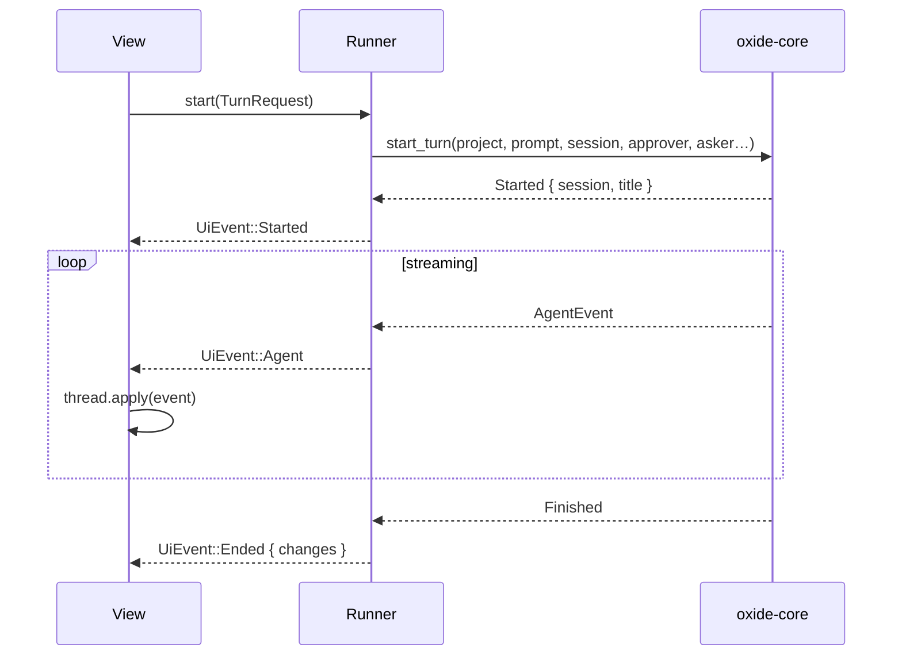

# The GPUI app

Oxide has two desktop front-ends over the same core:

- **Electron** — `crates/desktop/`, the app that ships today. Its window, menu
  bar, updater and packaging are unchanged by anything here.
- **GPUI** — `crates/desktop-gpui/`, a native window built with
  [Zed's GPUI](https://crates.io/crates/gpui) instead of a webview.

Both read the same `config.json`, `auth.json`, `settings.json`, project registry,
`trust.json`, sessions, shadow snapshots and approvals, because the GPUI app links
`oxide-core` directly and `oxide-desktop`'s library for the projects, sessions and
`@path` completion. Nothing is duplicated: a thread started in one app is listed
in the other, and a tool allowed with **Always allow** stops being asked about in
the terminal, the Electron window and here.

## Running it

```sh
cd crates/desktop-gpui
cargo run          # build and open the window
cargo test         # the state machine, transcript, theme and completion rules
```

The crate is its own Cargo workspace, like `crates/desktop`, so GPUI's large
dependency tree never enters the core workspace's build.

## What the window does

| Area | Behaviour |
| --- | --- |
| Sidebar | Projects from the shared registry plus folders discovered from sessions, with the selected project's threads under it, **+ New chat**, **Add project** (the native folder chooser), the theme toggle and **Check for updates**. |
| Header | The thread's summarized title, its folder, whether the project is trusted, and the model. |
| Transcript | User and assistant turns, a thinking block, a tool card per call (path/command, state, duration, output preview; click to unfold), informational lines, errors, and a card listing the files the turn changed. A reopened thread replays what it said and called. |
| Composer | A soft-wrapped text field with caret, selection and IME; `Enter` sends, `Shift+Enter` inserts a newline, `⌘C/⌘X/⌘V/⌘A` are the clipboard, `Esc` stops a running turn. An `@` reference completes the project's paths (gitignore-aware, the same rules as the terminal); a leading `/` lists the command catalog and completes the composer rather than running it. |
| Approval | A gated tool is asked about in a dialog: **Allow once**, **Always allow** (written to the shared `approvals.json`), or **Deny**. |
| Question | A skill's `ask` tool is answered in a dialog, one step at a time, with the options offered and a field for the user's own words. Dismissing it answers nothing. |
| Trust | A project with local resources asks **Trust this project?** before loading them, and saves the decision in the shared `trust.json`. |
| Queue | A message typed while a turn runs waits on the follow-up queue, listed above the composer; the run paints it as a turn when it is delivered. |
| Updates | **Check for updates** resolves this app's own `gpui-v*` release train and offers the bundle; installing downloads it, verifies the checksum and unpacks it over the running bundle. |

A turn that finishes raises the same desktop toast as the terminal and the
Electron app (`oxide_core::notify`, gated by the shared settings), named after
the thread.

## How a turn runs

`runner.rs` owns the tokio side and the window never awaits anything:



- The approver and asker announce a request over the same channel and wait on a
  one-shot answer, giving up after five minutes so a turn cannot hang.
- The MCP servers, plugin host and language servers of a project are kept across
  its turns (`TurnEnvironment`), so an edit's language server is warm for the
  next one.
- The turn's start is marked in the project's shadow snapshot, so what it
  changed is listed when it ends — including files no tool call named.
- `state.rs` is pure: the transcript's rules, the totals, the question form and
  the completion rows are unit tested without a window.

## The release train

The app releases from its own `gpui-v*` tag through
`.github/workflows/gpui.yml`, which builds macOS arm64 and x64, packages each
bundle and attaches it to the release:

```sh
crates/desktop-gpui/scripts/package-macos.sh --arch arm64
# → crates/desktop-gpui/artifacts/Oxide-GPUI-<version>-macos-arm64.app.tar.gz
```

The archive's name is what `oxide_core::updates::Component::Gpui::assets()`
resolves, so the app's updater and the release job agree on it by construction.
`scripts/set-version.sh gpui-v1.2.3` writes the version into the crate's
`Cargo.toml`, which is the number the app reports and compares a release
against. A checkout's build (`cargo run`) is not an `.app` bundle, so it is told
it cannot install over itself instead of writing over a file nobody installed.

## Not there yet

The window deliberately ships the conversation first. Still to come, in rough
order: attachments (paste and file picking), the model, reasoning and agent
pickers, MCP server management and `/permissions` listing in a dialog, undo on
the change card, worktrees, interface language, and the sidebar's pin, archive,
search and drag-to-reorder. Until then those stay with the Electron app and the
terminal, which share the same stores.
